# 应用启动过程详解

> 本 Markdown 是启动流程的当前维护来源；[配套 HTML](application-startup-process.html) 保留为历史可视化快照，不独立维护实现事实。

本文从入口开始梳理 JDesk Framework 当前应用启动链路。范围覆盖推荐的 Swing frame 启动器
`JdeskApplicationBuilder`，也覆盖测试或嵌入场景直接调用 `JdeskApplication.init()` /
`start()` 的路径。

如果 IDEA 的 Markdown 预览没有渲染 Mermaid 流程图，可以打开同目录的
[HTML 可视化版](application-startup-process.html)。

当前启动设计的核心原则是：

- 启动入口尽量薄，真正的流程集中在 coroutine-first 的 `JdeskApplicationCoroutines`。
- XML 和插件描述符先并行解析成模型，再按确定顺序注册到运行时容器。
- 服务和扩展默认懒加载，启动阶段优先注册描述符，不急于实例化实现类。
- UI 相关步骤只在 EDT 执行，非 UI 的解析、插件加载、服务注册尽量在后台完成。
- `StartupTrace` 贯穿全过程，用 span 和 counter 记录启动耗时、错误和注册数量。

## 完整流程图

```mermaid
flowchart TD
    Entry["入口<br/>JdeskApplicationBuilder.launchBlocking()<br/>或直接 JdeskApplication.init()/start()"]

    Entry --> Construct["创建 JdeskApplication<br/>校验 applicationClassLoader<br/>加载 ApplicationInfo 并设置 PathManager appId<br/>ApplicationStartupConfig.load()<br/>创建 StartupTrace<br/>创建 ApplicationTaskScope<br/>创建 ApplicationCore"]

    Construct --> BuilderPath{"是否走<br/>JdeskApplicationBuilder"}

    BuilderPath -- "是" --> FrameLaunch["frame.launch<br/>创建 frame-launch StartupScope"]
    FrameLaunch --> Scale["frame.scale.installEarly<br/>提前安装 UI 缩放"]
    Scale --> ParallelLaunch["frame.launch.parallel"]
    ParallelLaunch --> LafTask["EDT 异步<br/>frame.lookAndFeel.ensure"]
    ParallelLaunch --> InitAsync["application.initAsync()"]

    BuilderPath -- "否" --> InitAsync

    InitAsync --> InitStart["application.init<br/>状态检查 NOT_INITIALIZED<br/>ApplicationManager.setApplication(app)<br/>状态切换 INITIALIZING<br/>发布 beforeApplicationLoaded"]
    InitStart --> PathResolve["path.plugins.resolve<br/>解析插件目录<br/>安装 frame parent-first 包规则"]
    PathResolve --> InitParallel["application.init.parallel"]

    InitParallel --> CoreServices["core.initializeCoreServices()<br/>注册 core 扩展点 applicationService<br/>注册 StartupTrace/ApplicationInfo/ExtensionRegistry<br/>注册 MessageBusManager/PluginManager<br/>配置 VirtualFileManager 和 LocalFileSystem"]

    CoreServices --> ParseFanout["并行解析阶段<br/>只读文件和 XML<br/>不修改 registry/container"]
    ParseFanout --> PluginLoad["plugins.load<br/>确保 plugins 目录<br/>读取 bundled-plugins.xml<br/>发现插件目录/JAR<br/>并行解析 plugin.xml<br/>写入 PluginDescriptor 和 UNLOADED 状态"]
    ParseFanout --> FrameParse["frame.config.parse<br/>读取 META-INF/frame-plugins.xml<br/>解析 frame 扩展点和 applicationService<br/>生成 XmlConfigurationDescriptor"]
    ParseFanout --> AppParse["application.config.parse<br/>读取 META-INF/app-plugins.xml<br/>解析应用扩展点、内置扩展和 applicationService<br/>生成 XmlConfigurationDescriptor"]

    PluginLoad --> AwaitParsed["等待三个解析任务完成"]
    FrameParse --> AwaitParsed
    AppParse --> AwaitParsed

    AwaitParsed --> ApplyConfig["configuration.apply<br/>确定性注册阶段"]
    ApplyConfig --> ApplyFrame["applyFrameConfiguration<br/>注册 frame extensionPoint<br/>注册 frame applicationService 描述符"]
    ApplyFrame --> ApplyApp["applyApplicationConfiguration<br/>注册 app extensionPoint<br/>注册 app 内置 lazy extension<br/>注册 app applicationService 描述符"]

    ApplyApp --> PluginInit["core.initPlugins()<br/>按依赖拓扑顺序<br/>创建 PluginClassLoader<br/>注册插件声明的 extensionPoint<br/>插件状态 LOADED"]
    PluginInit --> Containers["core.initializeContainers()<br/>ExtensionRegistry.initialize()<br/>ServiceContainer.initialize()<br/>预加载 AWAIT/ASYNC 服务"]
    Containers --> Initialized["状态切换 INITIALIZED<br/>发布 applicationInitialized"]

    Initialized --> AfterInit{"是否走<br/>JdeskApplicationBuilder"}
    AfterInit -- "是" --> ComponentStore["componentStore.installDefault<br/>注册 ComponentStore<br/>登记已创建持久化服务<br/>订阅 onApplicationSaving 自动保存"]
    ComponentStore --> WaitLaf["等待 lookAndFeel.ensure 完成"]
    LafTask --> WaitLaf
    WaitLaf --> Theme["EDT<br/>frame.theme.applyConfigured<br/>JdfLafManager.applyConfiguredTheme()"]
    Theme --> Context["EDT<br/>frame.context.create<br/>解析窗口标题<br/>创建 MainFrame/ApplicationContext"]
    Context --> StartRuntimeBuilder["application.startRuntime<br/>状态切换 STARTING<br/>RuntimeParamRegistry.completeBoot()<br/>Dispatchers.Default 执行 core.startPlugins()"]

    AfterInit -- "否" --> DirectStart["JdeskApplication.start()/startAsync()"]
    DirectStart --> StartRuntimeDirect["application.start<br/>状态切换 STARTING<br/>RuntimeParamRegistry.completeBoot()<br/>Dispatchers.Default 执行 core.startPlugins()"]

    StartRuntimeBuilder --> PluginStart["PluginManager.startPlugins()<br/>按依赖拓扑顺序<br/>注册插件 lazy extension<br/>注册插件 applicationService 描述符<br/>插件状态 STARTED"]
    StartRuntimeDirect --> PluginStartDirect["PluginManager.startPlugins()<br/>同上"]

    PluginStart --> Activities["EDT<br/>application.activities<br/>扩展 ApplicationActivity<br/>builder applicationActivity<br/>legacy setup"]
    Activities --> BeforeUi["application.finishStartBeforeUiShown<br/>发布 beforeUiShown<br/>状态切换 RUNNING<br/>发布 onApplicationStarted"]
    BeforeUi --> ShowUi["EDT<br/>frame.ui.show<br/>显示 MainFrame<br/>markFirstWindowVisible()"]
    ShowUi --> PostStartup["EDT 异步任务<br/>postStartup.activities<br/>扩展 PostStartupActivity<br/>builder postStartupActivity<br/>legacy started<br/>异常只记录日志"]
    PostStartup --> FinishTrace["finishStartupTrace<br/>输出或写入启动 trace<br/>返回 JdeskApplication"]

    PluginStartDirect --> DirectBeforeUi["finishStartBeforeUiShown<br/>发布 beforeUiShown<br/>状态 RUNNING<br/>发布 onApplicationStarted"]
    DirectBeforeUi --> DirectDone["直接启动完成<br/>无 builder UI 创建和 Activity 调度"]

    Construct -. "构造或启动失败" .-> Failure["启动失败处理<br/>finishStartupTrace<br/>disposeAfterStartupFailure<br/>关闭 task scope/message bus/core/main frame<br/>清理 ApplicationManager<br/>可选 reportStartupFailureAndExit"]
    InitAsync -. "RuntimeException/Error" .-> Failure
    FrameLaunch -. "RuntimeException/Error" .-> Failure
```



## 启动入口

推荐入口是 `JdeskApplicationBuilder.create(...).launchBlocking()`。它创建 `JdeskApplication`，
执行 frame 层标准启动链，并在返回前完成应用初始化、插件启动、主窗口创建、启动活动执行和首窗显示。

`launch()` 只是 `launchBlocking()` 的兼容入口；`launchBlocking()` 内部通过
`JdeskApplicationCoroutines.launchBlocking(...)` 进入 Kotlin coroutine 启动链。还有一个
`launchOnEdt()`，它会创建名为 `jdesk-startup` 的非 daemon 后台线程，再在该线程中调用
`launchBlocking(true)`；这个方法适合普通 `main` 方法直接启动 Swing 应用。

测试或嵌入场景也可以直接创建 `JdeskApplication` 并调用：

```java
JdeskApplication app = new JdeskApplication(classLoader);
app.init();
app.start();
```

直接路径只处理应用基础设施和插件运行态，不创建 `MainFrame`，也不执行
`ApplicationActivity` / `PostStartupActivity` 这套 frame builder 启动活动。

## 构造阶段

`new JdeskApplication(applicationClassLoader)` 是所有路径的共同起点。构造函数本身不注册全局应用，
也不进入 `INITIALIZING`，但会准备启动所需的不可变基础对象。

构造阶段主要处理：

| 处理 | 说明 |
|---|---|
| 记录启动时间 | `startTimeMillis` 用于统计初始化总耗时。 |
| 校验类加载器 | `applicationClassLoader` 不能为空，后续 frame/app/plugin XML 都依赖它解析类型。 |
| 加载应用信息 | `ApplicationInfoLoader.load(applicationClassLoader)` 会读取 `META-INF/application-info.xml`，并把其中的 `id` 交给 `PathManager`，用于开发模式下解析 `.root/<appId>/`。 |
| 读取启动配置 | `ApplicationStartupConfig.load()` 会先 reset `RuntimeParamRegistry`，再读取 `PathManager.getSystemDir()/application.properties`，把属性写为 `STARTUP_CONFIG` 来源的 startup value。 |
| 定界面语言、注册框架文案 | `I18nStartup.initialize()` 优先取 `-Djdesk.locale`，否则按 `<config>/locale.properties` 与系统首选语言协商，再 `I18n.initialize` 设当前语言与 JVM 默认 locale；随后 `I18n.registerRoot("jdesk/i18n", …, UiLanguage.EN)` 注册框架文案。见 [多语言](i18n.md)。 |
| 创建启动追踪 | `StartupTrace.create()` 记录 span、counter、首窗显示时间和最终摘要。 |
| 创建应用任务域 | `ApplicationTaskScope("application")` 是 application-owned coroutine/task scope，用于服务预加载、post-startup activity 等应用级后台任务。 |
| 创建内核对象 | `ApplicationCore` 创建 `ExtensionRegistryImpl` 和 `ServiceContainerImpl(taskScope)`，但此时还没有注册 core 服务。 |

构造完成后，应用仍处于 `NOT_INITIALIZED`。

## Builder Frame 启动编排

`JdeskApplicationBuilder.launchAsync()` 是 frame 应用的推荐编排层。它负责把应用基础设施启动、
Swing 外观、主题、窗口上下文、启动活动和首窗显示串在一起。

启动开始时会创建 `JdeskStartupScope("frame-launch")`，并记录 `frame.launch` span。随后先执行
`frame.scale.installEarly`，调用 `JdfScale.installEarly()`，让 UI scale 在 Swing 控件创建前可用。

接着进入 `frame.launch.parallel`：

- 在 EDT 异步启动 `frame.lookAndFeel.ensure`，调用 `JdeskApplication.ensureLookAndFeel(startupTrace)`。
  其中 `frame.i18n.swingDefaults` 按构造阶段 `I18nStartup.initialize()` 定下的界面语言设置 Swing 默认 locale 与 `JdfFonts` 的字体语言，随后的 `frame.fonts.installDefaults` 据此挑界面字体，见 [多语言](i18n.md)。
- 在当前 coroutine 中执行 `frameApplication.initAsync()`。
- `initAsync()` 完成后，调用 `installComponentStoreIfNeeded(application)`。
- 等待 look and feel 任务完成。

这意味着 Look & Feel 初始化可以和应用基础设施初始化重叠；默认 `ComponentStore` 则必须等
`initAsync()` 完成，因为它要使用已经注册好的 `StartupTrace`、`ServiceContainer` 和应用级
`MessageBus`。

## 应用初始化阶段

`JdeskApplication.init()` 是 Java 阻塞包装器，内部调用 `initAsync()`。初始化只允许从
`NOT_INITIALIZED` 状态进入；重复调用会抛出 `IllegalStateException`。

`initAsync()` 的开头会：

1. 创建 `JdeskStartupScope("application-init")`。
2. 打开 `application.init` span。
3. `ApplicationManager.setApplication(app)`，建立全局应用访问点。
4. 状态切换为 `INITIALIZING`。
5. 发布 `beforeApplicationLoaded(app)`。
6. 记录插件目录解析 span `path.plugins.resolve`。
7. 调用 `JdeskApplication.installFrameParentFirstPackage()`，安装 frame 相关 classloader 委派规则。

`beforeApplicationLoaded` 发生很早。此时 core service 尚未注册，应用级 message bus 也可能尚未创建；
因此需要接收这个事件的代码应使用直接生命周期监听器，而不是依赖 message bus 订阅。

## Core 服务注册

`core.initializeCoreServices()` 是注册阶段的第一步，始终先于 frame/app/plugin 的运行时注册。

它做三类事情：

| 处理 | 结果 |
|---|---|
| 注册 core 扩展点 | 注册内置扩展点 `applicationService`，契约类型是 `AppServiceDeclaration`。 |
| 注册 core 服务 | 注册预构造实例 `StartupTrace`、`ApplicationInfo`、`ExtensionRegistry`；注册懒加载服务 `MessageBusManager -> MessageBusManagerImpl`、`PluginManager -> PluginManagerImpl`。 |
| 配置 VFS | 获取 `VirtualFileManager` 单例，设置当前应用，注册 `LocalFileSystem` 协议，并把 `VirtualFileManager` 作为实例服务注册到容器。 |

`ApplicationInfo` 在 `JdeskApplication` 构造阶段已经加载；core 注册阶段会把同一个实例注册到服务容器，
因此窗口标题、产品名和应用 ID 后续都可以通过 `app.getService(ApplicationInfo.class)` 获取。

core 注册完成后，服务容器中已经存在最基本的描述符，但 `ServiceContainer.initialize()` 还没有执行；
普通懒加载服务仍然只保存描述符，不会创建实例。

## 并行解析阶段

`application.init.parallel` 中先完成 core 注册，然后启动三个并行任务：

| 并行任务 | 调度 | 说明 |
|---|---|---|
| `plugins.load` | IO | 由 `PluginManager.loadPlugins()` 发现插件路径、读取 bundled 注册表、并行解析各插件 `plugin.xml`。 |
| `frame.config.parse` | Default | 由 `FrameConfigLoader.parseFrameConfiguration()` 读取 `META-INF/frame-plugins.xml`，生成 `XmlConfigurationDescriptor`。 |
| `application.config.parse` | Default | 由 `ApplicationConfigLoader.parseApplicationConfiguration()` 读取 `META-INF/app-plugins.xml`，生成 `XmlConfigurationDescriptor`。 |

这一阶段的边界很重要：frame/app XML 解析只生成模型，不修改 `ExtensionRegistry` 或
`ServiceContainer`。插件加载虽然会把解析完成的 `PluginDescriptor` 写入 `PluginManagerImpl`
内部状态，但它也不会创建插件类加载器，不会注册扩展点，也不会注册插件贡献的 service。

插件描述符解析本身还有一层并行：`PluginManagerImpl.parsePluginDescriptors(...)` 会创建
`JdeskStartupScope("plugin-descriptor-loading")`，对每个插件路径提交
`plugin.descriptor.parse:<path>` IO 任务，最后按发现顺序收集结果，写入 `descriptors` 和 `states`。

## 确定性注册阶段

三个解析任务全部完成后，启动链进入 `configuration.apply`。这里是 XML 模型转运行时状态的确定性边界。

当前顺序是：

1. core：已经由 `initializeCoreServices()` 直接完成。
2. frame：`applyFrameConfiguration(frameConfig)`。
3. app：`applyApplicationConfiguration(applicationConfig)`。
4. plugins：先在 `core.initPlugins()` 注册插件声明的扩展点；再在 `core.startPlugins()` 注册插件贡献。

`applyFrameConfiguration(...)` 会：

- 对每个 frame `extensionPoint` 执行 `Class.forName(..., appClassLoader)`。
- 调用 `extensionRegistry.registerExtensionPoint(name, extensionClass)`。
- 对每个 frame `applicationService` 加载 service interface class。
- 向 `ServiceContainer` 注册按类名创建的 `ServiceDescriptor`，并保留 XML 中的 `preload` 策略。

`applyApplicationConfiguration(...)` 会：

- 注册宿主应用声明的扩展点。
- 把宿主应用内置 `<extension>` 注册为 lazy `ExtensionDescriptor`。
- 把宿主应用 `<applicationService>` 注册为按类名创建的 service descriptor，缺省懒加载，也可通过 `preload="await|async"` 预加载。

如果某个扩展点或 service interface 类不存在，当前实现会记录 warn 并跳过对应声明；解析错误会计入
`StartupTrace` counter，并返回空 descriptor，避免单个 XML 文件阻断整个应用启动。

## 插件初始化阶段

XML 配置应用完成后，`core.initPlugins()` 调用 `PluginManager.initPlugins()`。

这一阶段按插件依赖拓扑顺序处理可加载插件：

1. 校验依赖图。
2. 缺失依赖、循环依赖或依赖不可加载时，把相关插件标记为 `FAILED`。
3. 为可加载插件创建 `PluginClassLoader`。
4. 状态写为 `LOADED`。
5. 解析插件声明的 `<extensionPoint>` contract class。
6. 注册插件声明的扩展点。

此阶段仍不会注册插件贡献的 `<extension>` 或 `<applicationService>`。原因是插件自己声明的扩展点需要在
容器初始化前准备好，而插件贡献则属于运行态启动内容，统一放到 `startPlugins()`。

## 容器初始化阶段

`core.initializeContainers()` 在 `initAsync()` 的后段执行，顺序是：

1. `extensionRegistry.initialize()`。
2. `serviceContainer.initialize()`。

服务容器初始化时会遍历已注册的 `ServiceDescriptor`：

- `ServicePreloadMode.AWAIT`：同步创建服务，启动等待其完成。
- `ServicePreloadMode.ASYNC`：通过 application-owned `ApplicationTaskScope` 异步预加载。
- 普通服务：保持懒加载，首次 `getService()` 时再创建。

服务创建会进入 `service.create:<class>` span。按类名注册的服务会在这一刻才加载实现类；如果实现类有
单参数 `Application` 构造器，则通过 `ApplicationManager.getApplication()` 注入当前应用，否则使用无参构造器。

容器初始化完成后，应用状态切换为 `INITIALIZED`，随后发布 `applicationInitialized(app)`。

## ComponentStore 安装

只有走 `JdeskApplicationBuilder` 时，才会默认安装 `ComponentStore`。安装条件是：

- builder 的 `installDefaultComponentStore` 为 `true`。
- 服务容器尚未注册 `ComponentStore.class`。

安装过程会：

1. 创建 `ComponentStore(PathManager.getConfigDir())`。
2. 作为应用级实例服务注册到 `ServiceContainer`。
3. 扫描并登记已经创建的 `PersistentStateComponent` 服务。
4. 通过应用级 `MessageBus` 订阅 `ApplicationLifecycleListener.onApplicationSaving`。
5. 应用保存事件触发时调用 `componentStore.saveAll()`。

这里第一次调用 `application.getMessageBus()` 可能会创建应用级 message bus，并触发
`MessageBusManagerImpl` 服务的懒加载。

## 主题、上下文和窗口创建

builder 等待 Look & Feel 任务完成后，进入 UI 相关阶段。这些步骤全部切换到
`Dispatchers.Swing`，也就是 EDT。

`frame.theme.applyConfigured` 会获取 `JdfLafManager` 服务并调用 `applyConfiguredTheme()`。
`JdfLafManager` 是 frame XML 注册的懒加载应用服务，首次获取时才创建。

接着解析窗口标题：

- 如果 builder 显式配置了 title，使用该 title。
- 否则使用 `ApplicationInfo.fullProductName`。

`frame.context.create` 在 EDT 调用 `frameApplication.createApplicationContext(effectiveTitle)`，创建：

- `MainFrame`。
- `ApplicationContext`。

`ApplicationContext` 是后续 `ApplicationActivity`、`PostStartupActivity`、legacy `setup` /
`started` 回调共同使用的上下文对象。

## 运行态启动和插件贡献注册

`JdeskApplication.start()` 是直接路径的启动入口；builder 路径不会直接调用完整 `startAsync()`，
而是拆成：

1. `startRuntimeAsync()`。
2. `ApplicationActivity`。
3. `finishStartBeforeUiShown()`。

这样 builder 可以在应用进入 `RUNNING`、首窗显示前执行关键 UI 装配活动。

`startRuntimeAsync()` 要求当前状态是 `INITIALIZED`，然后：

1. 状态切换为 `STARTING`。
2. `RuntimeParamRegistry.completeBoot()`，结束启动参数阶段。
3. 在 `Dispatchers.Default` 调用 `core.startPlugins()`。

`core.startPlugins()` 最终进入 `PluginManager.startPlugins()`。它按依赖拓扑顺序启动插件：

- 把插件 `<extension>` 注册为 lazy `ExtensionDescriptor`。
- 把插件 `<applicationService>` 注册为按类名创建的 `ServiceDescriptor`，并立即应用 `preload` 策略。
- 记录插件注册过的扩展和 service，供 `stopPlugin()` / `unloadPlugin()` 清理。
- 插件状态切换为 `STARTED`。

扩展实现类不会在这里实例化；只有首次查询扩展点时才会创建。插件服务实现类也不会在这里加载；
只有首次 `app.getService(ServiceInterface.class)` 时才会创建。

## ApplicationActivity

builder 路径在插件贡献注册完成后、应用进入 `RUNNING` 前执行 `application.activities`。

该阶段在 EDT 上执行，并且属于启动关键路径。任何 `ApplicationActivity` 抛出的
`RuntimeException` 或 `Error` 都会中断启动，进入 builder 的启动失败回滚。

执行顺序是：

1. 从扩展点 `deskframe.applicationActivity` 读取并运行扩展贡献。
2. 运行 builder 通过 `applicationActivity(...)` 添加的活动。
3. 运行 legacy `setup(...)` 适配成的 `builder.setup` 活动。

适合放在这里的工作包括：安装菜单、工具栏、窗口内容、设置页、工具窗口和其他首窗显示前必须完成的 UI 装配。

## 进入 RUNNING 和首窗显示

builder 路径在 `ApplicationActivity` 完成后调用 `finishStartBeforeUiShown()`：

1. 发布 `beforeUiShown(app)`。
2. 状态切换为 `RUNNING`。
3. 在应用任务域里提交后台任务 `io.tempfiles.sweep`，清扫 `config/` 下强杀残留的原子写临时文件，不等它完成。产品自己的数据目录由产品在启动后自行调用 `AtomicFiles.sweepStaleTempFiles` 清扫。
4. 发布 `onApplicationStarted(app)`。

随后 `frame.ui.show` 在 EDT 上执行：

1. `mainFrame.isVisible = true`。
2. `startupTrace.markFirstWindowVisible()`。

直接 `start()` 路径也会调用 `finishStartBeforeUiShown()`，但不会创建或显示 frame 窗口。

## PostStartupActivity

首窗显示后，builder 调用 `ApplicationActivityRunner.schedulePostStartupActivities(...)`。

post-startup 活动通过 application-owned `ApplicationTaskScope.launchEdt(...)` 投递到 EDT，
不阻塞 `launchBlocking()` 返回，也不影响启动 trace 完成。执行顺序是：

1. 扩展点 `deskframe.postStartupActivity` 的贡献。
2. builder 通过 `postStartupActivity(...)` 添加的活动。
3. legacy `started(...)` 适配成的 `builder.started` 活动。

Post-startup activity 的失败只会记录日志，不会关闭应用。这类活动适合做需要首窗已经可见的后续 UI 操作、
欢迎提示、非关键数据刷新等。

## 生命周期事件顺序

一次正常 builder 启动中，关键生命周期事件顺序是：

| 时机 | 事件 |
|---|---|
| `initAsync()` 早期 | `beforeApplicationLoaded(app)` |
| core/frame/app/plugin extension point 初始化完成后 | `applicationInitialized(app)` |
| 插件贡献注册完成、首窗显示前 | `beforeUiShown(app)` |
| 状态切换到 `RUNNING` 后 | `onApplicationStarted(app)` |
| 应用关闭准备保存时 | `onApplicationSaving(app)`，默认 `ComponentStore` 在这里保存状态 |

`beforeApplicationLoaded` 发生在 message bus 可能尚未创建前；后续事件会同时发送给直接监听器和已创建
message bus 上的订阅者。

## 线程和并发边界

当前启动链路的线程边界可以概括为：

| 阶段 | 执行位置 |
|---|---|
| `launchBlocking()` / `initBlocking()` / `startBlocking()` | 调用线程上的 `runBlocking`。 |
| Look & Feel、主题、窗口创建、Activity、首窗显示 | EDT / `Dispatchers.Swing`。 |
| 插件目录和插件 XML 解析 | `JdeskStartupScope.asyncIo(...)`。 |
| frame/app XML 解析 | `JdeskStartupScope.asyncDefault(...)`。 |
| 插件启动注册 | `Dispatchers.Default`。 |
| Post-startup activity | 应用级 `ApplicationTaskScope.launchEdt(...)`。 |
| ASYNC preload 服务 | 应用级 `ApplicationTaskScope.asyncIo(...)`。 |

并行解析只允许读输入和构造模型；修改 `ExtensionRegistry`、`ServiceContainer`、插件状态机中会影响运行时可见性的步骤，
都集中在后续确定性阶段执行。

## 失败和回滚

`initAsync()` 中如果发生 `RuntimeException` 或 `Error`，会先
`ApplicationManager.clearApplication(app)`，再向外抛出。

builder 路径会捕获启动失败，并执行：

1. 解包 coroutine 恢复出来的重复异常包装。
2. `finishStartupTrace(startupTrace)`，尽量输出启动 trace。
3. `rollbackStartup(frameApplication, failure)`。
4. `rollbackStartup` 调用 `disposeAfterStartupFailure(failure)`。
5. 如果 `exitOnStartupFailure` 为 `true`，调用 `StartupErrorReporter.showError(failure)` 并以固定退出码退出。
6. 否则重新抛出异常。

`disposeAfterStartupFailure(...)` 会尽量释放部分创建的资源，包括应用任务域、message bus、core
服务和可能已经创建的 main frame，并清理 `ApplicationManager`。它是 best-effort 清理：如果清理也失败，
清理异常会作为 suppressed exception 追加到原始启动失败上。

## 与 IntelliJ 思路的对应关系

当前实现借鉴的关键点是“并行读描述符，确定性注册运行时状态”：

- `frame-plugins.xml`、`app-plugins.xml` 和插件 `plugin.xml` 可以并行解析。
- 解析结果先落到不可变或局部模型中。
- 真正影响运行时行为的注册按 core -> frame -> app -> plugins 顺序执行。
- 插件贡献的扩展和服务延迟到运行态启动注册，并继续保持实现类懒加载。

这样既增加了启动并行粒度，又保留了可预测的注册顺序。后续如果继续扩展到 project-level 容器、
更多 descriptor 类型或更严格的插件兼容性检查，也可以沿用这个边界：解析阶段只收集事实，注册阶段统一裁决顺序。
