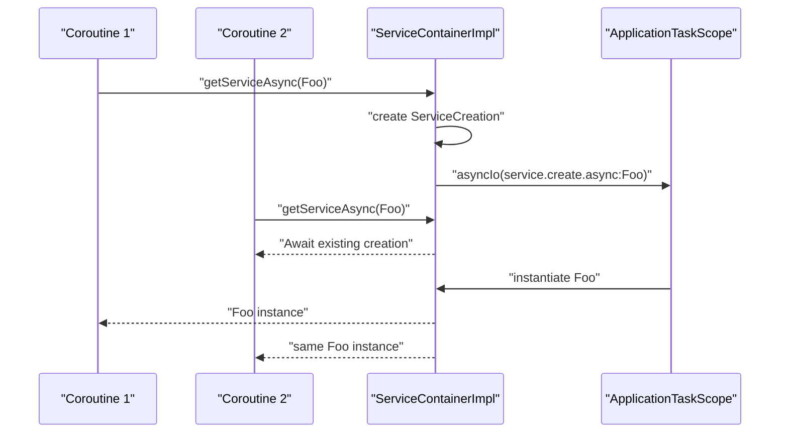
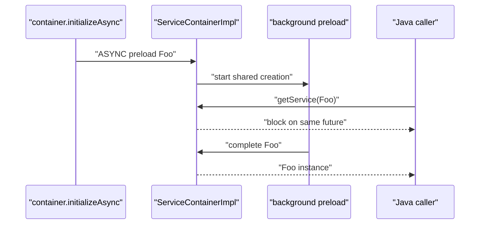

# ServiceContainerImpl 工作机制

本文说明 `ServiceContainerImpl` 的职责、内部状态、同步和异步服务访问机制、预加载策略、依赖环检测、启动追踪归属以及释放流程。

相关代码位于：

- `jdesk-framework-core/src/main/java/com/jdesk/core/service/ServiceContainer.java`
- `jdesk-framework-core/src/main/java/com/jdesk/core/service/CoroutineServiceContainer.kt`
- `jdesk-framework-core/src/main/java/com/jdesk/core/service/ServiceDescriptor.java`
- `jdesk-framework-core/src/main/java/com/jdesk/core/service/ServicePreloadMode.java`
- `jdesk-framework-core/src/main/java/com/jdesk/core/service/impl/ServiceContainerImpl.kt`

## 设计定位

`ServiceContainerImpl` 是应用级服务容器的默认实现。它负责把服务接口映射到服务实例或服务描述符，并在第一次访问时创建服务。

它的设计目标有三点：

1. 服务默认懒加载，避免启动阶段过早加载实现类。
2. 同步访问、协程访问、异步预加载共享同一个服务创建过程，避免并发重复实例化。
3. 服务创建过程纳入应用生命周期、启动 trace 和容器释放流程。

当前实现同时面向 Java 和 Kotlin：

- Java 代码主要使用 `ServiceContainer.getService(Class<T>)`。
- Kotlin 协程代码可以使用 `ServiceContainer.getServiceAsync<T>()`。
- 如果容器实现了 `CoroutineServiceContainer`，`getServiceAsync` 会走容器原生异步能力。
- 如果是其他旧容器实现，扩展函数会退化为 `withContext(Dispatchers.Default) { getService(...) }`。

## 核心接口关系

```mermaid
flowchart LR
    "ServiceContainer" --> "CoroutineServiceContainer"
    "CoroutineServiceContainer" --> "ServiceContainerImpl"
    "ServiceDescriptor" --> "ServiceContainerImpl"
    "ApplicationTaskScope" --> "ServiceContainerImpl"
    "StartupTrace" --> "ServiceContainerImpl"
```

`ServiceContainer` 是 Java 友好的基础接口，定义注册、查询、释放等能力。

`CoroutineServiceContainer` 是 Kotlin 协程友好的扩展接口，增加：

```kotlin
suspend fun <T : Any> getServiceAsync(serviceClass: Class<T>): T
```

`ServiceContainerImpl` 同时实现这两个接口，因此它既可以被传统 Java 启动代码使用，也可以被协程化启动流程直接使用。

## 内部状态

`ServiceContainerImpl` 维护几组关键状态：

| 字段 | 作用 |
|---|---|
| `descriptors` | 已注册的服务描述符，key 是服务接口类型。 |
| `instances` | 已经创建完成的服务实例。 |
| `creations` | 正在创建中的服务任务，每个服务最多一个。 |
| `serviceLocks` | 每个服务一个锁，保护该服务的注册、创建、替换、取消。 |
| `registrationOrder` | 服务注册顺序，释放时按反向顺序处理。 |
| `serviceParentDisposable` | 所有 `Disposable` 服务的父 disposable。 |
| `taskScope` | 承载异步服务创建任务的 `ApplicationTaskScope`。 |
| `initialized` | 容器是否已经进入初始化边界。 |
| `disposed` | 容器是否已经释放。 |

其中最关键的是 `creations`。它让不同入口共享同一个正在创建的服务：

- `getService()` 发现服务正在异步创建时，会阻塞等待同一个 `CompletableFuture`。
- `getServiceAsync()` 发现服务正在创建时，会 suspend 等待同一个 `CompletableFuture`。
- `ServicePreloadMode.ASYNC` 启动的后台创建任务也写入同一个 `creations`。

这就是“容器原生 serviceAsync”的核心，不再只是把同步 `getService()` 包一层 dispatcher。

## 服务描述符

`ServiceDescriptor<T>` 描述服务如何被创建。它支持三类来源：

| 来源 | 说明 |
|---|---|
| 已创建实例 | `ServiceDescriptor.ofInstance(...)`，访问时直接返回。 |
| 实现类 | `ServiceDescriptor.ofClass(...)`，首次访问时反射实例化。 |
| 实现类名 | `ServiceDescriptor.ofClassName(...)`，首次访问时先加载类再实例化。 |

按类名懒加载对插件服务尤其重要。注册插件 XML 时可以只记录实现类名和 classloader，不必在启动早期加载实现类。

服务实现类支持两种构造方式：

1. 单参数 `Application` 构造器。
2. 无参构造器。

如果服务实现类声明了 `Application` 构造器，`ServiceDescriptor` 会从 `ApplicationManager` 获取当前应用并注入。

## 访问流程

所有服务访问都会先进入 `prepareAccess(serviceClass)`，它返回三种结果：

| 结果 | 含义 |
|---|---|
| `Existing` | 服务实例已经存在，直接返回。 |
| `Await` | 服务正在创建中，当前调用方应该等待它。 |
| `Create` | 当前调用方成为创建者，负责启动或执行创建。 |

整体流程如下：

```mermaid
flowchart TD
    "getService / getServiceAsync" --> "checkNotDisposed"
    "checkNotDisposed" --> "prepareAccess"
    "prepareAccess" --> "instances has service?"
    "instances has service?" -->|"yes"| "Existing: return instance"
    "instances has service?" -->|"no"| "lock service"
    "lock service" --> "cycle check"
    "cycle check" --> "creations has service?"
    "creations has service?" -->|"yes"| "Await shared creation"
    "creations has service?" -->|"no"| "find descriptor"
    "find descriptor" --> "create ServiceCreation"
    "create ServiceCreation" --> "Create"
```

`prepareAccess` 只决定“谁创建、谁等待”，不直接执行耗时创建。这样同步入口和异步入口可以共享同一套并发控制逻辑。

## 同步 getService

`getService(Class<T>)` 是 Java 和旧代码的同步入口。

它的行为是：

1. 如果服务已经创建，立即返回。
2. 如果服务正在创建，调用 `future.get()` 阻塞等待。
3. 如果服务尚未创建，由当前线程直接执行创建。

伪代码：

```kotlin
override fun <T : Any> getService(serviceClass: Class<T>): T {
    return when (val access = prepareAccess(serviceClass)) {
        is Existing -> access.instance
        is Await -> awaitCreationBlocking(access.creation)
        is Create -> completeCreationInCurrentThread(access.creation, access.descriptor)
    }
}
```

这保证旧同步代码仍然可用。即使服务已经由异步 preload 或 `getServiceAsync` 启动创建，同步调用也不会再创建第二个实例，而是等待同一个创建结果。

## 原生 getServiceAsync

`getServiceAsync(Class<T>)` 是协程优先的访问入口。

它的行为是：

1. 如果服务已经创建，立即返回。
2. 如果服务正在创建，挂起等待同一个 `CompletableFuture`。
3. 如果服务尚未创建，提交一个 `ApplicationTaskScope.asyncIo(...)` 任务，然后挂起等待结果。

伪代码：

```kotlin
override suspend fun <T : Any> getServiceAsync(serviceClass: Class<T>): T {
    return when (val access = prepareAccess(serviceClass)) {
        is Existing -> access.instance
        is Await -> access.creation.future.awaitWithoutCancellingSharedCreation()
        is Create -> {
            startBackgroundCreation(access.creation, access.descriptor, "service.create.async:${serviceClass.name}")
            access.creation.future.awaitWithoutCancellingSharedCreation()
        }
    }
}
```

这里的重点是：服务创建属于容器内部共享状态，而不是某个调用方私有协程。

因此，如果两个协程同时调用同一个服务：

```kotlin
val a = async { services.getServiceAsync<MyService>() }
val b = async { services.getServiceAsync<MyService>() }
```

实际只会创建一次 `MyService`，两个协程等待同一个结果。

## ServiceCreation

`ServiceCreation<T>` 表示一次正在进行的服务创建。

它包含：

| 字段 | 作用 |
|---|---|
| `serviceClass` | 当前创建的服务接口类型。 |
| `future` | 创建结果，供同步和异步调用方共同等待。 |
| `parentSpanId` | 创建请求发生时的 startup trace 父 span。 |
| `started` | 确保后台创建任务只启动一次。 |
| `task` | 对应的 `ApplicationTask`，用于取消和状态管理。 |

`future` 是同步和协程之间的桥：

- 同步 `getService` 使用 `future.get()`。
- 异步 `getServiceAsync` 使用 `suspendCancellableCoroutine` 挂起等待。
- 后台任务完成后调用 `future.complete(instance)`。
- 创建失败时调用 `future.completeExceptionally(failure)`。

## 异步创建如何启动

后台创建通过 `startBackgroundCreation(...)` 启动：

```kotlin
private fun <T : Any> startBackgroundCreation(
    creation: ServiceCreation<T>,
    descriptor: ServiceDescriptor<T>,
    taskName: String,
) {
    if (!creation.started.compareAndSet(false, true)) {
        return
    }

    creation.task = taskScope.asyncIo(taskName, Callable {
        completeCreationInCurrentThread(creation, descriptor)
    })
}
```

`started` 是一个 `AtomicBoolean`，用于处理并发场景：

- 第一个调用方负责真正提交后台任务。
- 后续调用方只等待同一个 `future`。

异步创建使用 `ApplicationTaskScope.asyncIo`，意味着服务创建任务归属于应用生命周期。应用关闭或启动失败时，应用级 task scope 可以取消未完成的后台服务任务。

## 预加载策略

服务描述符可以设置 `ServicePreloadMode`：

| 模式 | 行为 | 是否阻塞初始化边界 |
|---|---|---|
| `NONE` | 不预加载，首次访问时创建。 | 否 |
| `AWAIT` | 容器初始化时同步创建。 | 是 |
| `ASYNC` | 容器初始化时提交后台创建。 | 否 |

初始化时的逻辑：

```kotlin
for ((serviceClass, descriptor) in descriptors.entries) {
    when (descriptor.preloadMode) {
        ServicePreloadMode.AWAIT -> getServiceUntyped(serviceClass)
        ServicePreloadMode.ASYNC -> startAsyncPreload(serviceClass)
        ServicePreloadMode.NONE -> Unit
    }
}
```

### AWAIT

`AWAIT` 表示服务必须在容器初始化边界内创建完成。

适合：

- 后续启动阶段立即依赖的基础设施服务。
- 创建失败应该尽早暴露的关键服务。
- 需要在 `applicationInitialized` 前保证存在的服务。

缺点是它会增加启动关键路径耗时。

### ASYNC

`ASYNC` 表示启动服务创建，但不等待它完成。

适合：

- 启动后很快可能会用到，但不是首屏必须的服务。
- 初始化较慢，但可以和 UI 显示、插件 start 等工作并行的服务。
- 允许调用方首次访问时等待结果的服务。

如果后台预加载尚未完成，后续 `getService()` 或 `getServiceAsync()` 会等待这次预加载创建，而不会重新创建。

## 注册和运行时替换

### registerInstance

`registerInstance(serviceClass, instance)` 注册一个已经创建好的实例。

它会：

1. 获取该服务的锁。
2. 如果同服务已有创建任务，取消它。
3. 把实例写入 `instances`。
4. 写入一个 `ofInstance` 描述符。
5. 记录注册顺序。
6. 如果实例是 `Disposable` 或 `PersistentStateComponent`，执行相应注册。

### registerService

`registerService(serviceClass, descriptor)` 注册懒加载描述符。

它会：

1. 获取该服务的锁。
2. 如果同服务已有创建任务，取消它。
3. 写入新的 descriptor。
4. 如果 descriptor 本身带有 prebuilt instance，则缓存实例。
5. 记录注册顺序。
6. 如果容器已经 initialized，则立即应用该 descriptor 的 preload 策略。

运行期注册 `AWAIT` 服务会立刻同步创建；运行期注册 `ASYNC` 服务会立刻启动后台创建。

### unregisterService

`unregisterService(serviceClass)` 会：

1. 取消该服务正在进行的创建任务。
2. 移除 descriptor。
3. 移除已创建实例。
4. 从注册顺序中移除该服务。
5. 如果实例没有被其他 service key 复用，则释放该实例。

## 服务实例缓存

创建完成后，`cacheCreatedInstance(...)` 会在服务锁内做最终确认：

1. 容器不能已经 disposed。
2. `creations[serviceClass]` 必须仍然是当前 creation。
3. `descriptors[serviceClass]` 必须仍然是当前 descriptor。
4. 确认通过后写入 `instances`。
5. 从 `creations` 移除当前 creation。

这些检查用于处理并发替换和释放：

- 如果服务正在创建时被反注册，创建结果会被丢弃并释放。
- 如果服务正在创建时 descriptor 被替换，旧创建结果不会污染新 descriptor。
- 如果容器已经关闭，刚创建出来的实例会立即释放。

## 依赖环检测

服务创建过程中允许服务构造器继续访问其他服务，例如：

```java
class A {
    A(Application app) {
        B b = app.getService(B.class);
    }
}
```

为了发现 `A -> B -> A` 这样的依赖环，容器使用 `ServiceCreationContext` 保存当前线程的服务创建栈。

创建服务前会把服务类型压入栈：

```text
[A]
```

如果 `A` 创建过程中访问 `B`，则栈变成：

```text
[A, B]
```

如果 `B` 又访问 `A`，`cycleFor(A)` 会发现 `A` 已经在当前栈中，于是抛出：

```text
ServiceInitializationCycleException: Service initialization cycle: A -> B -> A
```

这类错误会 fail-fast，不会让调用方进入无意义的等待。

### 跨线程环（等待图检测）

线程栈只能看见当前线程的嵌套创建。若 `A`、`B` 互相依赖且两个创建在不同线程并发进行（典型场景：双方都声明 `preload="async"`，或两个线程同时懒加载），线程栈互相不可见，单靠栈检测不到环——旧实现中两个线程会在对方的 future 上永久互等（静默死锁）。

为此容器维护一张等待图：创建中的服务在等待共享创建结果前，先登记「当前创建 → 目标创建」的边，并沿目标创建的 `waitingOn` 链回溯。同一线程里嵌套创建时，外层创建会一直阻塞到内层完成，所以也登记一条「外层 → 内层」的边，内层结束后清掉；否则像 A→B→C→A 这样的环（线程 1 创建 A 并嵌套创建 B，线程 2 创建 C）回溯时走不通，仍会静默死锁。这条边指向刚开始的创建，它还没有出边，不会让图出现环。等待图在每次登记前都查过环、始终无环，因此：

- 回溯途中遇到当前创建，说明这条新边会闭合环，立即抛出同一个 `ServiceInitializationCycleException`（携带完整环路径）；
- 两个线程并发互等时，后登记的那条边必然闭合环，检测是确定性的，不依赖时序。

这两条结论靠一把监视器（`waitGraphLock`）成立：`waitingOn` 边只在它下面读写，查环和加边是一个原子步骤，每条边加入前都查过环，图因此始终无环；每个创建至多一条出边，沿 `waitingOn` 链回溯必然走到一个没有出边的创建而终止。两个线程并发互等时，两次登记被这把锁串行化，后进锁的一方一定看得见先登记的那条边。边的起点取自当前线程创建栈（`ServiceCreationContext`）的栈顶，两套机制因此互补：线程栈检出同一线程里的嵌套环，等待图检出跨线程的互等。协程版 `getServiceAsync` 必须在挂起前、在调用线程上登记边（挂起后可能换线程，线程栈就看不见了）；清边放在恢复或取消后的 `finally` 里，可能跑在别的线程上，所以同样走这把锁。

普通调用方（不在任何服务构造流程中）不登记边，也不会构成环的一环，环检测对它们零开销。

等待图检测覆盖由「直接等待」和「同一线程里的嵌套创建」构成的环。边界：若服务构造器自行 spawn 线程或协程、再由子执行体转回 `getService`/`getServiceAsync`，边不会登记（创建栈不跨执行体传播），此类环仍表现为等待挂起而非显式异常。

等待边还假设：登记边的线程会一直阻塞到目标创建完成。构造器里有两种用法会打破这个假设：

- 在同一线程上并发跑多个协程去等不同服务（例如 `runBlocking` 里 `launch` 多个 `getServiceAsync`）：这些等待共用同一条边，会互相覆盖，可能漏检，环仍表现为挂起。
- 用不阻塞构造器的方式等服务（例如在 `Dispatchers.Unconfined` 协程里调 `getServiceAsync`）：构造器其实没有阻塞，边却还挂着，可能误报环。

构造器里别这样访问服务；需要的依赖直接用 `getService` 同步取。

## 创建失败和重试

服务创建失败时，容器会：

1. unwrap 反射调用包裹的 `InvocationTargetException` 或 `ExecutionException`。
2. 从 `creations` 中移除当前 creation。
3. 用真实异常完成 `future.completeExceptionally(...)`。
4. 把异常重新抛给当前调用方。

从 `creations` 移除失败 creation 很重要。它表示失败不会被永久缓存，下一次访问可以重新尝试创建服务。

这种策略适合当前框架阶段：

- 临时环境问题可以通过重试恢复。
- 测试中可以验证首次失败、再次访问成功的场景。
- 后续如果需要更严格的失败缓存策略，可以在 descriptor 或 service policy 层扩展。

## StartupTrace 归属

服务创建可能由不同线程触发，尤其是 `getServiceAsync` 和 `ASYNC` preload。

为了让 trace 报告中服务创建 span 挂到正确父节点下，`prepareAccess` 创建 `ServiceCreation` 时会捕获当前 trace 父 span：

```kotlin
parentSpanId = StartupTraces.getCurrent().currentSpanId
```

真正创建服务时，容器会恢复这个父 span：

```kotlin
startupTrace.withParentSpan(creation.parentSpanId, Callable {
    startupTrace.runSpan("service.create:${serviceClass.name}") { span ->
        span.detail("service", serviceClass.name)
        descriptor.createInstance()
    }
})
```

这样即使服务创建发生在后台 IO 线程，trace 树仍然能表达“是谁发起了这次服务创建”。

## PersistentStateComponent 注册

服务实例缓存时，容器会检查它是否实现 `PersistentStateComponent`。

如果满足以下条件，会把它注册到 `ComponentStore`：

1. 实例实现了 `PersistentStateComponent`。
2. 实例类上存在 state annotation。
3. `ComponentStore` 服务已经创建。
4. 当前实例本身不是 `ComponentStore`。

注意这里使用的是 `getServiceIfCreated(ComponentStore.class)`，不会因为注册普通服务而主动创建 `ComponentStore`。

这是一个重要边界：服务缓存可以顺手接入持久化系统，但不能因此扩大启动关键路径。

## Disposable 和释放顺序

服务释放有两层机制：

1. 单个服务实例如果实现了 `Disposable`，会注册到 `serviceParentDisposable`。
2. 容器 `dispose()` 时，也会按 `registrationOrder` 的反向顺序逐个释放服务实例。

`dispose()` 的主要步骤：

1. 如果已经 disposed，直接返回。
2. 标记 disposed。
3. 取消所有 pending creations。
4. 如果容器拥有自己的 `ApplicationTaskScope`，取消 task scope。
5. 按注册顺序的反向顺序释放已创建服务。
6. 释放 `serviceParentDisposable`。
7. 清空 `instances`、`descriptors`、`creations`、`serviceLocks`、`registrationOrder`。

反向释放顺序符合常见依赖关系：后注册的服务通常更上层，应该先释放。

## 取消语义

容器会在以下场景取消正在创建中的服务：

- 容器 dispose。
- 同一 service 注册了新实例。
- 同一 service 注册了新 descriptor。
- service 被 unregister。

取消时会：

1. 调用对应 `ApplicationTask.cancel()`。
2. 用 `CancellationException` 完成共享 `future`。

等待该 future 的同步或异步调用方都会收到取消异常。

需要注意的是，调用方取消自己的 `getServiceAsync` 等待，不会取消共享的服务创建。因为创建任务属于容器，而不是某一个调用方。只有容器生命周期变化或服务注册状态变化才会取消创建任务。

## 并发场景示例

### 两个协程同时获取同一个服务



### 异步 preload 和同步访问相遇



这个场景说明 `ASYNC` preload 并不是“另起炉灶”。后续同步访问会接住同一个后台创建结果。

## 与 ApplicationTaskScope 的关系

`ServiceContainerImpl` 不直接暴露 Kotlin `CoroutineScope`。

它通过 `ApplicationTaskScope` 提交后台任务：

- 对 Java API 更友好。
- 任务有名称、状态、失败信息和取消能力。
- 应用关闭或启动失败时可以统一取消。
- 单个服务任务失败只记录在任务和日志中，不会自动取消整个应用。

默认构造器：

```kotlin
constructor() : this(ApplicationTaskScope("service-container"), true)
```

用于独立测试或临时容器，此时容器拥有自己的 task scope，`dispose()` 会取消它。

应用正式运行时通常注入应用级 `ApplicationTaskScope`：

```kotlin
constructor(taskScope: ApplicationTaskScope) : this(taskScope, false)
```

这种情况下容器不拥有 task scope，应用生命周期负责统一取消。

## 使用建议

### 默认使用懒加载

除非服务确实在启动关键路径中必须可用，否则优先使用 `ServicePreloadMode.NONE`。

### 谨慎使用 AWAIT

`AWAIT` 会直接增加启动初始化耗时。只有在服务必须在初始化边界前完成时才使用。

典型场景：

- 核心路径配置服务。
- 启动后立即被多个组件假设已经存在的基础设施。
- 初始化失败应该阻止应用继续启动的服务。

### 用 ASYNC 预热可能很快被访问的服务

`ASYNC` 适合启动后短时间内可能会用到，但不是首屏必须的服务。

它可以把创建工作和其他启动任务重叠起来。如果用户或后续流程提前访问该服务，调用方会等待同一个后台创建结果。

### Kotlin 启动代码使用 getServiceAsync

协程启动代码中优先使用：

```kotlin
val service = app.serviceContainer.getServiceAsync(MyService::class.java)
```

或 reified 扩展：

```kotlin
val service = app.serviceContainer.getServiceAsync<MyService>()
```

这让服务创建不会阻塞当前协程线程，并且可以和其他启动任务结构化组合。

### Java 代码继续使用 getService

Java 代码可以继续使用：

```java
MyService service = app.getService(MyService.class);
```

它会和异步创建任务共享结果，不会破坏单例语义。

## 当前边界和后续改进

当前实现已经把服务异步创建变成容器原生能力，但仍有一些明确边界：

1. 服务构造器仍然是同步 API。真正的 suspend 初始化流程尚未引入。
2. 依赖环检测覆盖同线程嵌套创建（线程栈）与跨线程 future 等待（等待图）；构造器自行 spawn 子线程/子协程再转回访问的环不在此列（见「依赖环检测」一节）。
3. 服务失败不会永久缓存，下一次访问会重试。
4. `ASYNC` preload 任务失败会记录在 `ApplicationTask` 和日志中，首次显式访问同一服务时会看到失败或触发重试，取决于失败发生后访问时机。
5. 当前尚未引入 IntelliJ 风格更完整的 service async dependency graph 或 app service preloading activity 模型。

后续可以继续演进：

- 为服务增加显式依赖声明，让容器在启动图中更早发现依赖关系。
- 引入 suspend initializer，让服务构造和异步初始化分离。
- 把服务 preload 纳入 `ApplicationActivity` 或专门的 service preload activity。
- 为 critical service 和 non-critical service 增加不同失败策略。
- 在 trace 报告中把 service preload、lazy create、dependency wait 区分成更细的 span。

## 小结

`ServiceContainerImpl` 当前的核心机制可以概括为：

```text
descriptor 注册服务来源
instances 缓存已创建实例
creations 共享正在进行的创建任务
ApplicationTaskScope 承载异步创建
CompletableFuture 桥接同步等待和协程等待
StartupTrace 记录服务创建归属
Disposer 统一释放服务资源
```

因此，服务容器现在不只是一个同步 lazy map，而是应用启动图中的一部分。它既保留 Java 同步访问的兼容性，也给 Kotlin 协程启动流程提供了真正共享、可追踪、可取消的异步服务创建能力。
